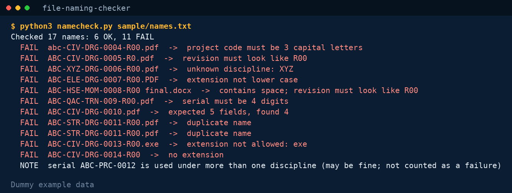

# File Naming Checker (Python)

A small script that checks a list of document file names against a naming convention and reports which ones break it, and why. Standard library only, no installs. Dummy example data.

**Convention used in this example** (change the lists at the top of `namecheck.py` to match your project):

`PROJ-DISC-TYPE-NNNN-Rnn.ext`, for example `ABC-CIV-DRG-0012-R02.pdf`

| Field | Rule |
|---|---|
| PROJ | 3 capital letters |
| DISC | CIV, ARC, STR, MEC, ELE, HSE, QAC |
| TYPE | DRG, RPT, SPC, MOM, TRN, PRC |
| NNNN | 4 digits |
| Rnn | R00 to R99 |
| ext | pdf, docx, xlsx, dwg (lower case) |

**What it flags:** wrong number of fields, lower-case project code, unknown discipline or type, short serial, bad revision, spaces, missing or disallowed extension, upper-case extension, exact duplicate names (case-insensitive), and control characters. It also prints a NOTE (not a failure) when the same serial appears under two disciplines; that can be legitimate, so you can switch it off with `NOTE_SERIAL_REUSE = False`.

## Walkthrough (English)

1. Put one file name per line in a text file. Try `sample/names.txt`.
2. Run: `python namecheck.py sample/names.txt sample/report.csv`
3. Read the summary on screen. Each FAIL line shows the name and every rule it breaks.
4. Open `report.csv` in Excel to filter by status and send the list to the people who named the files.
5. The script exits with code 1 when any name fails, so it can be used in a script.
6. The report is saved with a UTF-8 BOM so Excel shows Arabic names correctly. Cells that start with `=`, `+`, `-` or `@` get a leading apostrophe so Excel does not run them as formulas. The script refuses to write the report over the input file.

Run the tests: `python -m unittest discover -s tests` (30 tests).

## الشرح بالعربي

السكريبت ده بيفحص أسماء ملفات المستندات على نظام التسمية المتفق عليه، ويقولك أي اسم مخالف وليه. بيانات المثال وهمية.

**نظام التسمية في المثال:** `PROJ-DISC-TYPE-NNNN-Rnn.ext` مثلا `ABC-CIV-DRG-0012-R02.pdf`

1. اكتب كل اسم ملف في سطر في ملف نصي. جرّب `sample/names.txt`.
2. شغّل: `python namecheck.py sample/names.txt sample/report.csv`
3. هتشوف الملخص على الشاشة، وكل سطر FAIL فيه الاسم وكل قاعدة كاسرها.
4. افتح `report.csv` في Excel وفلتر على الحالة وابعت القائمة لمن سمّى الملفات.
5. لو أي اسم غلط السكريبت بيرجع كود 1، ولو فيه خطأ في الملفات بيرجع 2 برسالة قصيرة.
6. الملف بيتحفظ UTF-8 عشان Excel يعرض العربي صح، وأي خانة تبدأ بـ `=` أو `+` أو `-` أو `@` بتتحط قبلها علامة ' عشان Excel ما يشغّلهاش كمعادلة. والسكريبت بيرفض يكتب التقرير فوق ملف الأسماء.

عدّل القوائم في أول `namecheck.py` (التخصصات وأنواع المستندات والامتدادات) لتناسب مشروعك.

## Limits

- Checks names only, not file contents or whether the document exists in the register.
- The convention above is an example, not a standard. Tested with Python 3.10 on Linux only; not tested on Windows or in desktop Excel.
- It does not check that revisions are in order.
- The input file must be a UTF-8 text file, one name per line. How to list a folder's names is not covered here; I have not tested that on Windows.

## Notice (see NOTICE.md)

© 2026 Hussein Abdallah. All rights reserved.
